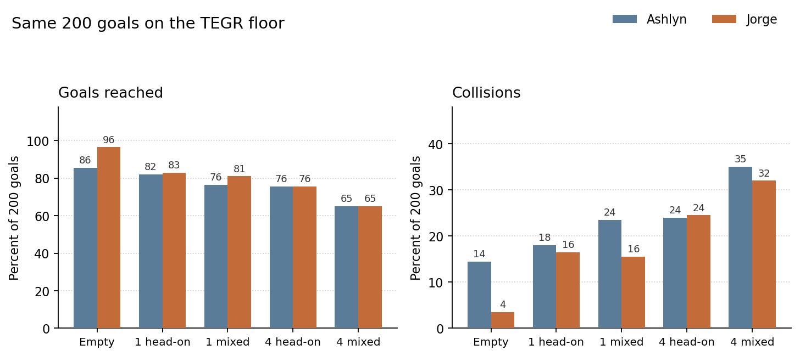

# CBU Autonomous Robot

A robot that escorts students through the CBU Engineering building using a single 2D LiDAR.
Simulation and the learned driver live here. The real robot is a Jetson Orin Nano.

`hallway` is a short practice corridor. `cbu_floor2` is the real TEGR 2nd floor. Training
happens in a fast 2D simulator on the saved map. The same policy runs in Gazebo.

The driver is two pieces. A passing rule picks a lane around a person. A small network turns
the LiDAR scan and that lane into a speed command. The current network is `tegr_dagger_dh_s0`.
Its weights are not in git.

## Jorge and Ashlyn

Same 200 goals on the TEGR floor, 12 Nov. Subgoal 1.5 m ahead, passing rule on, side held
for the whole pass. Ashlyn's model is `tegr_ppo_la15_s0`. Jorge's is `tegr_dagger_dh_s0`.

Jorge is ahead on an empty corridor and crashes less when one person mixes yielding and
crossing. One person walking straight at the robot, and a crowd of four, are ties. Ashlyn
finishes the successful trips about 4 seconds faster. With the rule turned off both reach
the goal about 41% of the time. The scripted lane follower, which reads the map, still leads
the head-on case at 86.5%. Full times are in `WORKLOG.md`. Older models are in `docs/MODELS.md`.

## Where things are

| Path | What it is |
|---|---|
| `src/cash_sim/worlds/cbu_floor2.sdf` | TEGR floor in Gazebo |
| `src/cash_sim/worlds/hallway.sdf` | Practice hallway |
| `maps/cbu_floor2.*` | Map the 2D trainer and the passing rule use |
| `src/cash_rl/cash_rl/spec.py` | Observation, action, reward, collision |
| `src/cash_rl/cash_rl/raycast_env.py` | Fast 2D simulator |
| `src/cash_rl/cash_rl/decision.py` | Passing rule |
| `src/cash_rl/cash_rl/train.py` | Training |
| `WORKLOG.md` | Session notes, newest first |
