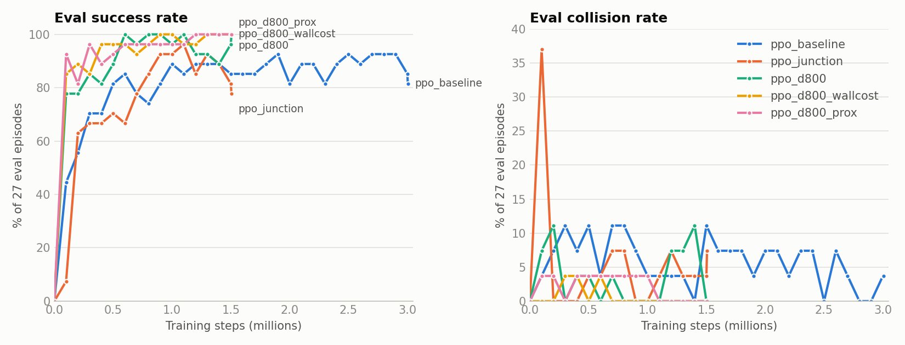

# Model comparison

Every navigation policy trained so far: what task each one learned, how it was trained, and how it
scored. The sections from the Summary through Collision analysis cover the hallway models and were
measured on 2026-10-15. Each model was evaluated with the code it was trained on, so each row is
scored on its own task. [TEGR floor and pedestrians](#tegr-floor-and-pedestrians) (2026-10-23/30)
and [Subgoal lanes and the subgoal agent](#subgoal-lanes-and-the-subgoal-agent) (2026-10-30/31)
cover the later models.

**Where things stand (2026-10-31)**
- **Hallway, no pedestrians: `ppo_d800_prox`** (seed 0, best checkpoint), the latest released model
  ([`models-2026-10-15`](https://github.com/leonjorge010/cbu-autonomous-robot/releases/tag/models-2026-10-15)).
  Over three seeds its setup averages **93.4% success and 4.2% collisions** (see
  [Seed variation](#seed-variation)). It predates scan stacking (it sees 1 scan, 41 values);
  current code still runs it through `train.load_model`, which feeds it only the newest scan.
- **TEGR floor with a pedestrian, learned end to end: `tegr_dagger_sg3`** (3 seeds) behind the
  safety layer: **94.7%** without pedestrians, **73.3%** on the encounter test. See
  [TEGR floor and pedestrians](#tegr-floor-and-pedestrians).
- **Hierarchy:** the rule-based decision layer over `downhill` reaches 91% on the encounter test
  and the learned subgoal agent 73.5%, but `downhill` reads the map and isn't deployable, and the
  PPO motion agents don't follow lanes yet. See
  [Subgoal lanes and the subgoal agent](#subgoal-lanes-and-the-subgoal-agent).

## Summary

Held-out test: 200 random start/goal pairs the policy never saw in training or in periodic
evaluation (random start heading, goals 1–15 m away by path distance; the 7 doors cover the longer 4–24 m trips).

| Model | Task | Success | Collisions | Timeouts | Steps reversing | All 7 doors |
|---|---|---|---|---|---|---|
| `ppo_baseline` | old sensor, fast reverse | 93.0% | 6.0% | 1.0% | 51.9% | ✅ (also in Gazebo) |
| `ppo_junction` | old sensor, fast reverse | **96.0%** | **3.0%** | 1.0% | 50.5% | ✅ (also in Gazebo) |
| `ppo_d800` (best) | real LiDAR, slow reverse | 90.5% | 8.0% | 1.5% | 8.0% | ✅ |
| `ppo_d800` (final) | real LiDAR, slow reverse | 93.0% | 7.0% | 0.0% | 8.6% | ✅ |
| `ppo_d800_wallcost` (best) | + corner-safe route | 92.0% | 5.5% | 2.5% | 10.7% | ✅ |
| `ppo_d800_wallcost` (final) | + corner-safe route | 91.5% | 8.5% | 0.0% | 9.2% | ✅ |
| `ppo_d800_prox` (best) ⭐ | + proximity penalty | **96.5%** | **3.0%** | 0.5% | 8.4% | ✅ (also in Gazebo) |
| `ppo_d800_prox` (final) | + proximity penalty | 96.0% | **3.0%** | 1.0% | **8.2%** | ✅ |

The newer models do a slightly harder task (noisy real sensor, slow reverse), so the two groups
are not directly comparable. What changed:
- **Reversing dropped from ~51% to ~8% of steps.** The old models drove backward half the time
  instead of turning around.
- **Learning got faster:** 90% eval success at 0.1–0.6M steps vs 0.9–1.9M.
- **Collisions rose with the real sensor, then came back down.** They went from the old 3% to
  5.5–8.5%, and the proximity penalty brought them back to 3%. See
  [Collision analysis](#collision-analysis).

## The task each model learned

Every model drives from a start pose to a goal point using only LiDAR and the goal's relative
position. Settings that differ between models are in bold.

| Setting | `ppo_baseline` | `ppo_junction` | `ppo_d800` | `ppo_d800_wallcost` | `ppo_d800_prox` |
|---|---|---|---|---|---|
| LiDAR model | ideal | ideal | **LDROBOT STL-27L** | STL-27L | STL-27L |
| Scan points / range | 360 / 0.15–12 m | 360 / 0.15–12 m | **2160 / 0.03–25 m** | 2160 / 0.03–25 m | 2160 / 0.03–25 m |
| Range the policy sees | 12 m | 12 m | **10 m** | 10 m | 10 m |
| Range noise (std dev) | 1.0 cm | 1.0 cm | **1.5 cm** | 1.5 cm | 1.5 cm |
| Missing returns (training) | none | none | **3% of beams** | 3% of beams | 3% of beams |
| Max forward / reverse speed | 0.5 / 0.5 m/s | 0.5 / 0.5 m/s | 0.5 / **0.15** m/s | 0.5 / 0.15 m/s | 0.5 / 0.15 m/s |
| Training goal distance | 1–15 m | **1–25 m** | 1–25 m | 1–25 m | 1–25 m |
| Junction-crossing episodes | 0% | **30%** | 30% | 30% | 30% |
| Near-wall path cost | none | none | none | **within 0.6 m of a wall** | within 0.6 m of a wall |
| Proximity penalty | none | none | none | none | **up to 0.5/step within 0.3 m** |

**Same for every model**
- **Observation (41 values):** 36 LiDAR distances, one every 10°, divided by the max range. Goal
  distance / 30 m, cos and sin of the goal bearing, and the previous action.
- **Action (2 values in [-1, 1]):** forward speed and turn rate (max 1.0 rad/s), sent every 0.1 s.
  Acceleration limits are 1.0 m/s² and 2.0 rad/s².
- **Reward per step:** 10 × (decrease in path distance to the goal) − 0.01. Reaching the goal
  (within 0.3 m) gives +10. A collision gives −20. Both end the episode.
  - The path distance goes *around* walls, not straight through them.
  - From `ppo_d800_wallcost` on, it charges extra near walls: 1 + 8 × (1 − c / 0.6)² per meter for a
    point c meters from a wall, which is 3× at the collision boundary. The cheapest route then
    rounds corners 0.46 m from the wall instead of 0.25 m.
  - `ppo_d800_prox` also subtracts 0.5 × (1 − c / 0.3)² each step that the gap c between the robot's
    edge and the nearest obstacle is under 0.3 m. That's 0.13 at 0.15 m and 0.35 at the 5 cm
    collision margin. For comparison, driving forward at full speed earns about 0.5 per step.
- **Collision:** anything within 5 cm of the 0.50 × 0.49 m robot footprint.
- **Episode time limit:** 2 × the time to drive the path distance at full speed, plus 10 s.

## Training setup (identical for all five)

| | |
|---|---|
| Algorithm | PPO ([Stable-Baselines3](https://stable-baselines3.readthedocs.io/) 2.9.0, PyTorch 2.14 CPU) |
| Network | Separate actor and critic MLPs, each 41 → 256 → 256 (tanh), Gaussian action head |
| Parameters | 153,861 total; **77,060 in the actor** (the part that runs on the robot) |
| Parallel environments | 12 (`SubprocVecEnv`) |
| Rollout per update | 512 steps × 12 envs = 6,144 transitions |
| Minibatch / epochs | 256 / 10 (240 gradient steps per update) |
| Learning rate | 3e-4 (constant) |
| Discount γ / GAE λ | 0.99 / 0.95 |
| Clip range / entropy coef. | 0.2 / 0.0 |
| Seed | 0 (one seed per setup) |
| Simulator | 2D raycaster on the SLAM map, ~2,300 steps/s per core |
| Periodic evaluation | every 100k steps, deterministic: 7 doors from spawn + 20 fixed random pairs = 27 episodes. `best_model.zip` is the checkpoint with the highest success rate on these |

## Training results

| Model | Steps | Wall time | First ≥90% eval | Best eval (27 episodes) |
|---|---|---|---|---|
| `ppo_baseline` | 3.0M | 36 min | 1.9M | 93% at 1.9M |
| `ppo_junction` | 1.5M | 14 min | 0.9M | 96% at 1.1M |
| `ppo_d800` | 1.5M | 27 min | 0.6M | 100% at 0.6M |
| `ppo_d800_wallcost` | 1.5M | 26 min | 0.4M | 100% at 0.9M |
| `ppo_d800_prox` | 1.5M | **11 min** | **0.1M** | 100% at 1.2M (and every eval after) |

Wall times are on an RTX 4060 laptop (CPU only, 22 threads). `ppo_d800` and `ppo_d800_wallcost` were
slowed by other jobs sharing the CPU. `ppo_d800_prox` had the machine to itself, which is what a
1.5M-step run normally takes.

**The 27-episode evaluation is too small to rank models.** All three D800 runs hit 100% there but
scored 90–96.5% on the 200-goal test. Use the curves to see learning speed and stability, and the 200-goal
test to compare final quality.

## Detailed held-out results

200 held-out random pairs (2D). Time and path are averaged over successful episodes only. Path is
the distance driven ÷ the shortest path distance at the start.

| Model | Success | Collision | Timeout | Avg. time | Path | Reversing | Return |
|---|---|---|---|---|---|---|---|
| `ppo_baseline` | 93.0% | 6.0% | 1.0% | 15.3 s | 1.01 | 51.9% | +74.5 |
| `ppo_junction` | 96.0% | 3.0% | 1.0% | 15.8 s | 1.03 | 50.5% | +77.6 |
| `ppo_d800` best | 90.5% | 8.0% | 1.5% | 16.5 s | 1.05 | 8.0% | +72.2 |
| `ppo_d800` final | 93.0% | 7.0% | 0.0% | 16.5 s | 1.04 | 8.6% | +74.2 |
| `ppo_d800_wallcost` best | 92.0% | 5.5% | 2.5% | 17.4 s | 1.03 | 10.7% | +76.1 |
| `ppo_d800_wallcost` final | 91.5% | 8.5% | 0.0% | 16.6 s | 1.00 | 9.2% | +74.1 |
| `ppo_d800_prox` best | 96.5% | 3.0% | 0.5% | 16.3 s | 0.99 | 8.4% | +78.8 |
| `ppo_d800_prox` final | 96.0% | 3.0% | 1.0% | 16.2 s | 0.98 | 8.2% | +78.8 |

Returns from `ppo_d800_wallcost` and `ppo_d800_prox` use different rewards, so returns can't be
compared across those rows.

**Doors from spawn:** every model reaches all 7 classroom doors with no collisions, in 29.4–30.5 s
on average. **Gazebo:** `ppo_baseline`, `ppo_junction` and `ppo_d800_prox` (best) each reached 7/7
doors in Gazebo with no collisions, and their returns were within 0.5 of 2D. For `ppo_d800_prox`,
Gazebo used the STL-27L sensor model (2160 beams, 0.03–25 m), and episodes took 1–11 fewer steps
than in 2D. `ppo_d800` and `ppo_d800_wallcost` have not been run in Gazebo.

## Seed variation

`ppo_d800_prox` was trained three times with identical settings and seeds 0, 1 and 2. Each row is
200 held-out goals.

| Seed | Checkpoint | Success | Collisions | Timeouts | Reversing |
|---|---|---|---|---|---|
| 0 | best | 96.5% | 3.0% | 0.5% | 8.4% |
| 0 | final | 96.0% | 3.0% | 1.0% | 8.2% |
| 1 | best | 91.5% | 6.0% | 2.5% | 7.9% |
| 1 | final | 94.0% | 5.5% | 0.5% | 8.6% |
| 2 | best | 92.0% | 3.5% | 4.5% | 12.2% |
| 2 | final | 90.5% | 4.0% | 5.5% | 16.4% |
| **Mean ± std** | best | **93.3 ± 2.8%** | **4.2 ± 1.6%** | 2.5 ± 2.0% | 9.5 ± 2.4% |
| **Mean ± std** | final | **93.5 ± 2.8%** | **4.2 ± 1.3%** | 2.3 ± 2.8% | 11.1 ± 4.6% |

All three seeds reach all 7 doors from spawn.

- **Seed 0 was the luckiest run.** Its 96.5% / 3.0% is about one standard deviation above the
  mean, so compare setups by the mean, not by seed 0.
- **One-seed comparisons above are within this noise.** The ±3% spread in success is as large as
  most of the differences between the seed-0 models in the Summary.
- **Seed 2 fails differently.** 10 of its 11 timeouts end 0.4–1.1 m from the goal, with the robot
  moving back and forth in place. It reaches the goal area and then can't finish the last
  approach. That habit is also where its extra reversing comes from. Seeds 0 and 1 rarely do this.
- **"Best" checkpoints aren't reliably better** than the end-of-training model. They're picked on 27
  episodes, which is too few to pick between checkpoints.

## With the safety layer

`cash_rl/safety.py` sits between the policy and the wheels. Before sending a command, it simulates
the motion over the robot's stopping time (up to ~0.6 s). If the robot's edge would come within
10 cm of any LiDAR point, it substitutes a gentler command: less speed, then no turning, then a
stop. Moving away from an obstacle is always allowed. It is pure numpy, so the same code can run on
the Jetson.

The same 200 held-out goals, end-of-training `ppo_d800_prox` models, 2D:

| Seed | Without: success / collisions / timeouts | With safety layer | Steps overridden |
|---|---|---|---|
| 0 | 96.0% / 3.0% / 1.0% | 96.5% / **0.5%** / 3.0% | 2.7% |
| 1 | 94.0% / 5.5% / 0.5% | 95.5% / **0.5%** / 4.0% | 3.1% |
| 2 | 90.5% / 4.0% / 5.5% | 91.0% / **1.0%** / 8.0% | 3.7% |
| **Mean** | 93.5% / 4.2% / 2.3% | **94.3% / 0.7% / 5.0%** | 3.2% |

All seeds still reach 7/7 doors from spawn with the safety layer on.

- **Collisions fall about 6×,** and success doesn't drop. Most episodes that would have collided
  become timeouts: the robot stops short instead of hitting the wall.
- **The layer only intervenes on about 3% of steps,** so the policy still does almost all the driving.
- **Gazebo, with the full 2160-beam STL-27L scan:**
  - With the layer on, `ppo_d800_prox` (best) reached 7/7 doors, and the layer never intervened.
    So it raises no false alarms in normal driving, junction turns or door approaches.
  - Driving at full speed into the end wall, straight and at an angle, it collided both times
    without the layer. With the layer it stopped **10.2 cm and 10.4 cm** from the wall, right at
    the 10 cm margin.
- The 2D results above use a 360-beam scan for the safety layer, to keep raycasting cheap.

## Collision analysis

Where the 2D collisions happen on the 200-goal test:

| Model | Collisions | East corner of the junction (x ≈ 15) | West corner (x ≈ 13) | Elsewhere |
|---|---|---|---|---|
| `ppo_d800` final | 14 | **12** | 1 | 1 (fountain area, x ≈ 18) |
| `ppo_d800_wallcost` best | 11 | 3 | **6** | 2 (fountain area, x ≈ 18) |
| `ppo_d800_prox` best | 6 | 1 | 2 | 2 (fountain area), 1 (end wall, started 0.47 m away) |

- **In `ppo_d800`, the reward itself caused the collisions.** The route the reward follows passed
  0.25 m from the corners, but anything closer than 0.295 m counts as a collision. The near-wall
  path cost fixed that, and east-corner hits fell from 12 to 3.
- **The collisions then moved to the west corner.** Most come from episodes that start inside the
  junction facing a random direction. The robot is nearly always at full speed (0.5 m/s) when it
  hits. At that speed its tightest turn has a 0.5 m radius, so it swings wide into the wall.
- **The proximity penalty supplied the missing signal.** Nothing in the earlier rewards said "slow
  down near walls." The penalty brought corner hits from 9 to 3 and total collisions from 11 to 6.
  Most of what's left comes from awkward starts, such as inside the junction or facing a wall.
- **The water fountain** sticks out into the corridor and now causes as many hits as the corners.
  Training with random obstacles, the next planned step, should help with it.

## TEGR floor and pedestrians

Measured 2026-10-23 to 10-30 on `cbu_floor2` (the real TEGR 2nd floor; unseen by hallway models).
200 held-out goals 1–15 m away, final checkpoints; three-seed rows give the mean and each seed.

**What changed from the hallway models**
- **Observation (113 values):** the last 3 scans (0.1 s apart, so moving things show up), goal,
  previous action. With `--subgoal-lookahead 3` the "goal" is a point 3 m ahead on the route
  (the real goal only within 3 m); reward and success still use the real goal.
- **Pedestrians:** 0.25 m discs walking the corridor at 0.5–0.9 m/s that don't yield; hitting one
  costs −40, and the robot pays for being close to one or standing in its path.
- **Encounter test:** one pedestrian starts on the robot's route walking toward it, every episode.
- **DAgger** (`dagger`): a student network copies `scripted.avoider`, a controller that reads the
  pedestrians' true positions and future paths, on the states the student itself visits.
  20 rounds × 60k labelled steps, 1 pedestrian, 70% encounter episodes.

**Hallway → TEGR without retraining** (hallway PPO, 1.5M steps, `ppo_d800_prox` settings, 3 seeds):

| Model | Hallway | TEGR | TEGR timeouts |
|---|---|---|---|
| `ppo_nosg` (no subgoal) | 92.8% (94.0/91.5/93.0) | 56.8% (57.0/54.5/59.0) | 37.8% |
| `ppo_sg3` (3 m subgoal) | 93.0% (95.5/88.0/95.5) | **72.5%** (73.0/65.0/79.5) | 16.5% |

The subgoal costs nothing on the training map and adds 15.7 points on the unseen floor, mostly by
halving the timeouts.

**Trained on TEGR, no pedestrians**

| Model | Success | Notes |
|---|---|---|
| `tegr_ppo` (PPO 3M, 3 seeds) | 84.3% (86.5/79.5/87.0) | failures mostly wall collisions (10–14%) |
| `tegr_dagger_r20` (DAgger, no subgoal) | 87.2% (84.5/88.0/89.0) | |
| `tegr_dagger_sg3` (DAgger, 3 m subgoal) | 88.7% (88.5/88.0/89.5) | collisions 10.5–12% |
| `tegr_dagger_sg3` + safety layer | **94.7%** (93.5/95.5/95.0) | collisions 0.5–1.5%, timeouts 4–5% |
| `tegr_ppo_lane_s0` (PPO, 3 m subgoal + lanes, 1 seed) | 94.0% | see the next section |
| `downhill` (scripted, reads the map) | 100% | |

**Encounter test, 1 pedestrian**

| Model | Success |
|---|---|
| `tegr_ppo` (trained without pedestrians) | 42.0% |
| `downhill` (ignores pedestrians) | 50.5% |
| `tegr_ppo_p1` (PPO with 1 pedestrian, 1 seed) | 52.0% |
| `tegr_dagger_p1` (DAgger, 10 rounds, 1 seed) | 61.5% |
| `tegr_dagger_r20` (20 rounds, no subgoal) | 64.8% (63.0/65.0/66.5) |
| `tegr_dagger_sg3` (20 rounds, 3 m subgoal) | 68.8% (66.5/69.0/71.0) |
| `tegr_dagger_sg3` + safety layer | **73.3%** (72.5/75.0/72.5) |
| `scripted.avoider` (teacher, reads pedestrians) | 89.0% |

- **PPO alone barely learns to avoid** (52%, 21% of steps reversing); copying the avoider works
  better. Every DAgger model beats `downhill` by 14–20 points.
- **The subgoal helps the student:** every `sg3` seed beats its no-subgoal partner (+2.5 to +4.5).
- **DAgger has plateaued** at ~round 10 (per-round eval wanders 57–70% after). The student averages
  the teacher's hard left and right swerves into going straight (5% hard-swerve steps vs the
  teacher's 43%), so the gap to the teacher won't close with more rounds. This is what the
  decision layers in the next section address: pick the side, then follow it.
- **4 pedestrians, encounter test** (trained with 1): `tegr_dagger_sg3` 63.7% (62.5/61.0/67.5),
  `downhill` 47.0%, avoider 87.5%.

## Subgoal lanes and the subgoal agent

Measured 2026-10-30/31 on `cbu_floor2` (the real TEGR 2nd floor, ~140 m of corridor), one seed
each. These models use the current observation (113 values: the last 3 scans plus the goal and
previous action), so they aren't comparable to the hallway rows above.

**The hierarchy.** A planner puts the motion agent's goal on the route 3 m ahead (the *subgoal*;
the real goal only within 3 m). A decision layer moves that subgoal sideways into a *lane* (up to
±1 m from the corridor center) to steer around pedestrians. The motion agent is paid to follow
the lane: −2.0 per step per meter it sits more than 0.1 m off it (0.5 for `tegr_ppo_lane_s0`),
waived in turns, junctions, open areas and the last 3 m, so following a lane away from the goal
costs only time.

### Motion agents

PPO, same hyperparameters as above (113 → 256 → 256), 3M steps, goals 1–25 m, subgoal 3 m ahead,
random lanes up to ±0.6 m redrawn every 2–6 s, no pedestrians. 200 held-out goals; `lane` is the
mean sideways distance (m) from the lane on charged steps.

| Model | Lane penalty | Random lanes | Lane +0.5: success / `lane` | Center | Lane −0.5 |
|---|---|---|---|---|---|
| `tegr_ppo` (no subgoal, 3 seeds) | — | 84.3% | — | — | — |
| `tegr_ppo_lane_s0` | 0.5 | **94.0%** | 93.0% / 0.41 | 93.0% / 0.23 | 90.5% / 0.37 |
| `tegr_ppo_lane_w2_s0` | 2.0 | 93.5% | 93.5% / 0.49 | 91.5% / 0.25 | 90.0% / 0.26 |
| `downhill` (scripted, reads the map) | — | — | 100% / 0.16 | 100% / 0.13 | 100% / 0.15 |

- **Following a subgoal 3 m ahead helps goal-reaching:** 84% → 94% on TEGR.
- **Neither PPO model really follows lanes.** With the lane pinned at +0.5 / 0 / −0.5 m,
  `tegr_ppo_lane_w2_s0` drives at +0.09 / −0.07 / −0.22 m from center: about 30% of the shift.
  Quadrupling the penalty changed nothing.
- **Why:** not the reward (following costs `downhill` nothing else, and is worth +21 per episode)
  and not training length (checkpoints from 500k to 3M steps follow equally little). A 0.5 m lane
  shift moves a point 3 m ahead by only ~9°, closing the gap takes ~6 s of driving, and lanes
  change every 2–6 s; the policy steers about twice as hard from its LiDAR position (back to the
  center) as from the subgoal. A controller that only steers at the observed subgoal follows no
  better (0.36 m). The same controller gets 0.20 m (= `downhill`) with a 1.5 m lookahead and lanes
  held 8–15 s, so `tegr_ppo_la15_s0` is being trained with those settings (`--subgoal-lookahead
  1.5 --lane-hold 8 15`).

### Decision layers

**Rule-based layer** (`cash_rl/decision.py`): when a pedestrian ahead is closing, put the lane
0.8 m beside their line on the side with more room. Reads the true pedestrian positions.
**Learned subgoal agent** (`cash_rl/subgoal_agent.py`): PPO, picks a lane (±1 m) and whether to
wait every 0.5 s from LiDAR only (3 scans 0.5 s apart, subgoal, goal, lane room, velocity), no
pedestrian positions. Trained 1M decisions (~105 min) over a frozen motion agent, 1 pedestrian,
70% of episodes start with one walking toward the robot.

Encounter test: 1 pedestrian walking toward the robot along its route, 200 held-out goals.

| Motion agent | Center lane | Rule-based layer | Learned subgoal agent |
|---|---|---|---|
| `downhill` | 53.0% | **91.0%** | **73.5%** (`tegr_subgoal_dh_s0`) |
| `tegr_ppo_lane_s0` | 47.5% | 51.0% | — |
| `tegr_ppo_lane_w2_s0` | 50.5% | 53.0% | 53.0% (`tegr_subgoal_w2_s0`) |
| scripted avoider (reads pedestrians) | 89.0% | 94.0% | — |

- **The hierarchy works when the motion agent follows its lane:** over `downhill` the rule-based
  layer adds 38 points and the learned agent 20.
- **Over the PPO motion agents neither layer helps,** because they barely move into the lane.
- **The learned agent trails the rule-based layer by 17.5 points** over `downhill`. Part of that
  is information: it sees only LiDAR. Its periodic eval was flat at ~70% at the end of training.
- **It doesn't cost goal-reaching:** without pedestrians, `tegr_ppo_lane_w2_s0` +
  `tegr_subgoal_w2_s0` reaches 94.5%.

## Caveats

- **Only `ppo_d800_prox` has multiple seeds.** It spreads ±2.8% in success and ±1.6% in
  collisions across seeds, and the other setups are probably similar. Their single-seed differences
  of a few percent aren't meaningful.
- **Gazebo covers only the 7 doors from spawn.** Random start poses aren't supported there yet.
- **The proximity penalty in Gazebo** measures distance from the scan, while 2D uses the map. They
  agree to about one map cell (5 cm), and the policy never sees the penalty at run time.
- **The hallway models trained on one map** with no people or moving obstacles. The TEGR lane and
  subgoal-agent models are single seeds; the encounter tests use one pedestrian.

## Reproducing

Commands are run from `~/ros2_ws`. Each run's `config.json` (included in the releases) records
every setting.

| Model | Code | Train command |
|---|---|---|
| `ppo_baseline` | `5cb4ade` | `ros2 run cash_rl train --name ppo_baseline --timesteps 3000000` |
| `ppo_junction` | `5cb4ade` | `ros2 run cash_rl train --name ppo_junction --timesteps 1500000 --goal-distance-range 1 25 --junction-prob 0.3` |
| `ppo_d800` | `14351b5` | same as `ppo_junction` |
| `ppo_d800_wallcost` | `b333324` to `4081d99` | same as `ppo_junction` |
| `ppo_d800_prox` | `5f4369e` or later | same as `ppo_junction` |
| `ppo_sg3_s{0,1,2}` | `b4b6dd7` or later | `ros2 run cash_rl train --name ppo_sg3_s0 --timesteps 1500000 --goal-distance-range 1 25 --junction-prob 0.3 --eval-random 20 --subgoal-lookahead 3 --seed 0` (`ppo_nosg`: same without `--subgoal-lookahead`) |
| `tegr_ppo` (+ `_s1`, `_s2`) | `14b094d` or later | `ros2 run cash_rl train --name tegr_ppo --map cbu_floor2 --goal-distance-range 1 25 --eval-random 40` |
| `tegr_dagger_sg3_s{0,1,2}` | `b4b6dd7` or later | `ros2 run cash_rl dagger --name tegr_dagger_sg3_s0 --map cbu_floor2 --pedestrians 1 --encounter-prob 0.7 --rounds 20 --subgoal-lookahead 3 --seed 0` (`tegr_dagger_r20`: same without `--subgoal-lookahead`) |
| `tegr_ppo_lane_s0` | `134f9fb` | `ros2 run cash_rl train --name tegr_ppo_lane_s0 --map cbu_floor2 --goal-distance-range 1 25 --eval-random 40 --subgoal-lookahead 3 --subgoal-offset 0.6 --seed 0` |
| `tegr_ppo_lane_w2_s0` | `b324cff` or later | same as `tegr_ppo_lane_s0` |
| `tegr_subgoal_w2_s0` | `d8ba369` or later | `ros2 run cash_rl train_subgoal --motion runs/tegr_ppo_lane_w2_s0/final_model.zip --map cbu_floor2 --pedestrians 1 --encounter-prob 0.7 --seed 0` |
| `tegr_subgoal_dh_s0` | `d8ba369` or later | same with `--motion downhill` |

Evaluate any model with
`ros2 run cash_rl evaluate runs/<name>/best_model.zip --random 200` (TEGR models: the map and
subgoal settings come from `config.json`; pin a lane with `--lane-offset 0.5`, run the encounter
test with `--pedestrians 1 --encounter-prob 1`, add `--decision-layer` or `--subgoal-agent ZIP`). Run the old models' code
(`git checkout 5cb4ade`) to score them on their own task. On current code they score worse,
because they rely on fast reverse. All D800 models share the same observation and action, so they
run unchanged on current code. Only their training reward differed.
